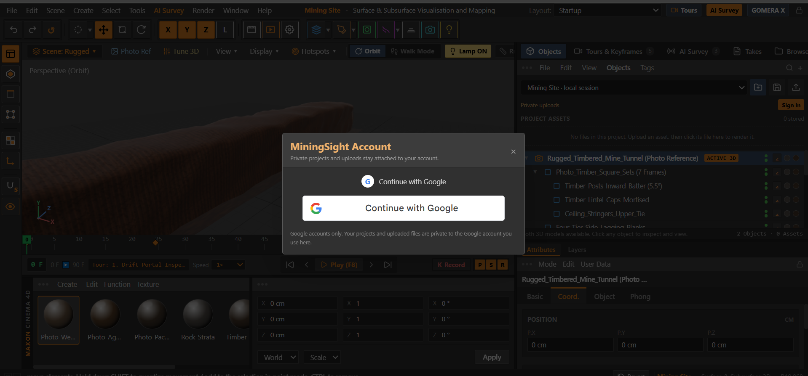
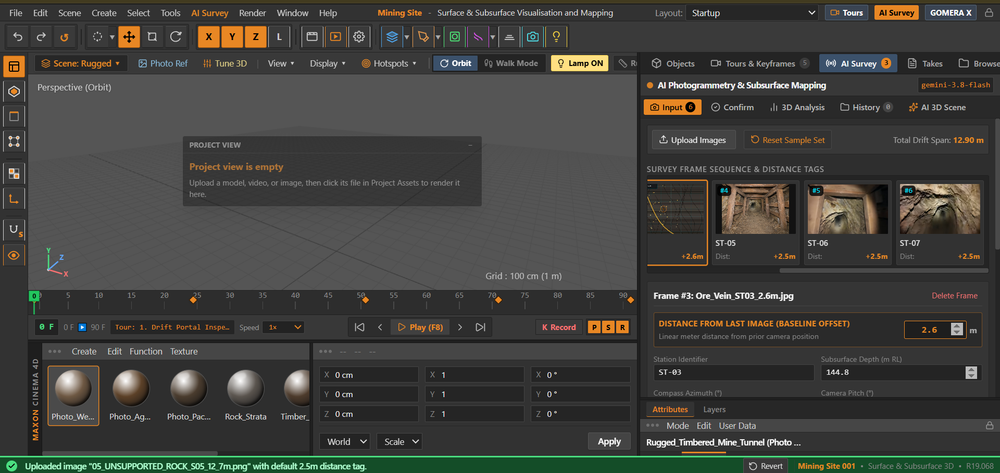
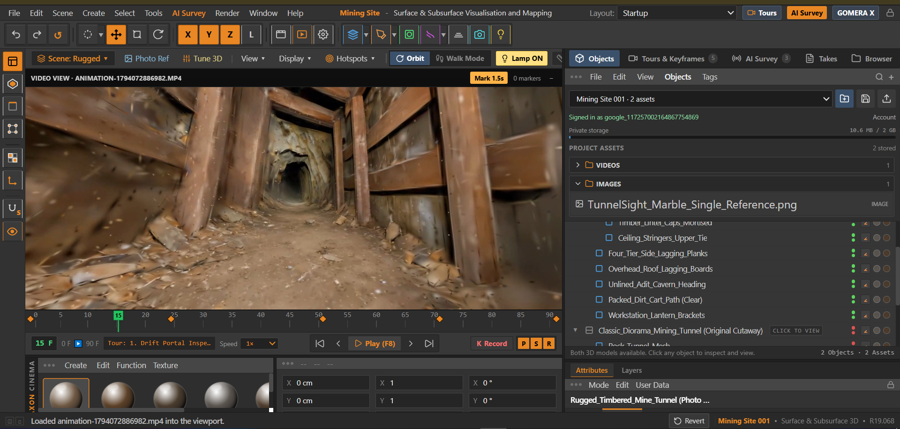
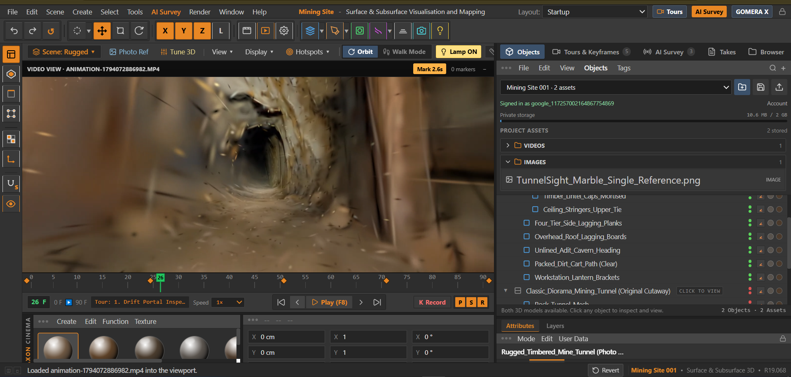
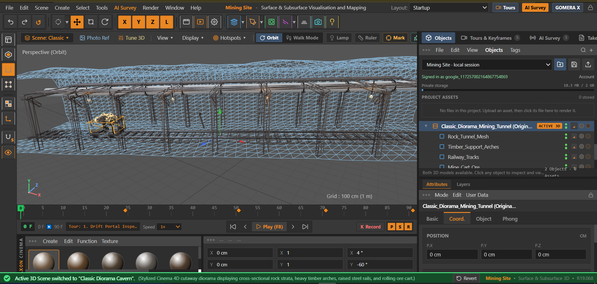
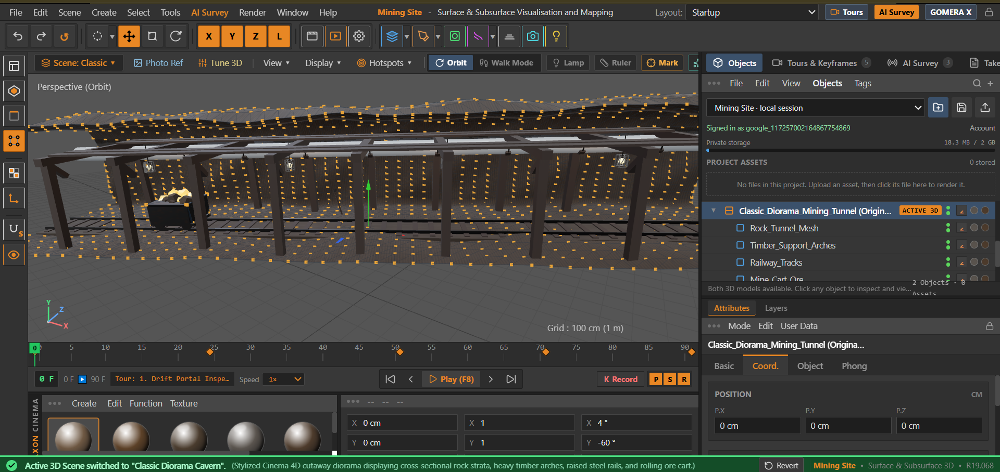
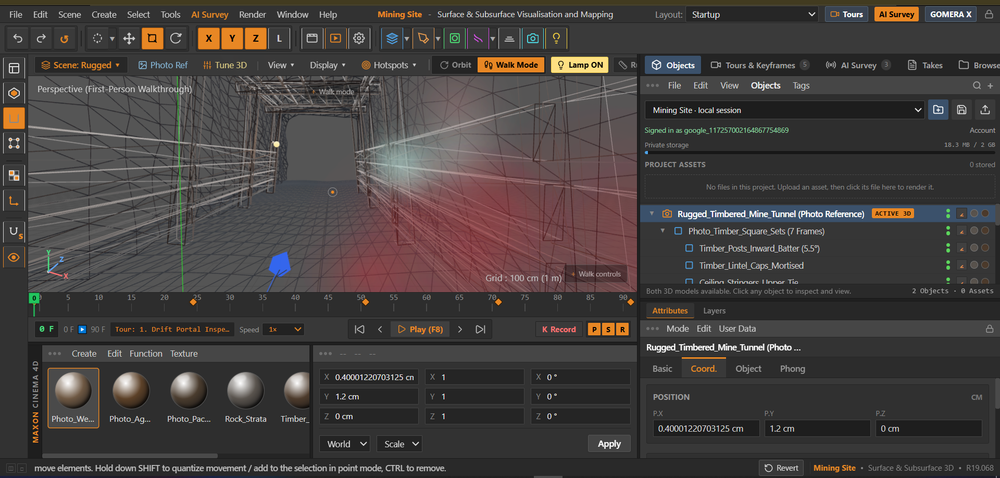
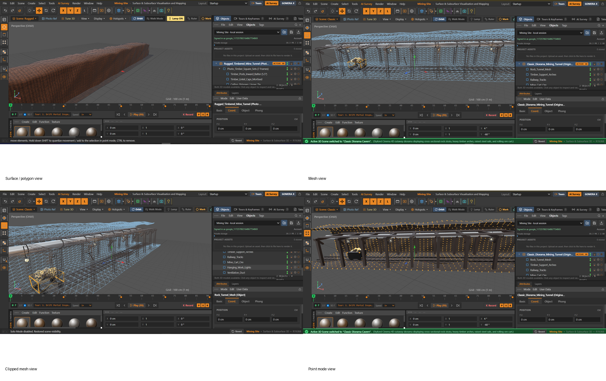

# MiningSight

MiningSight is an interactive surface and subsurface visualisation workstation for mine surveys, 3D reconstruction, site media, measurements, annotations, and presentation-ready review.

**Project author:** Ezekiel Rego

**Repository:** [github.com/ezekielrego/MiningSight](https://github.com/ezekielrego/MiningSight)

## Live interfaces

- Main interface: [tunnelsight.applications.co.zw](https://tunnelsight.applications.co.zw/)
- GOMERAX trial interface: [tunnelsight.applications.co.zw/gomerax-trial/](https://tunnelsight.applications.co.zw/gomerax-trial/)

The main interface includes a top-navigation switcher for moving between the connected visualisation experiences. Both interfaces use the same hosted environment while keeping their application routes and provider workflows separate.

## Selected system evidence

The following screenshots are selected from the supplied system evidence package to show the implemented workflows and interface states.

### Authentication and AI survey workflow



*Google authentication used before accessing private projects and uploads.*



*AI Survey workspace for loading reference images and recording inter-frame distance tags.*

### Reconstructed model review



*A returned reconstructed tunnel model loaded into the 3D workstation.*



*Interior inspection view for reviewing the reconstructed mine tunnel.*

### Representation and gas-mapping views



*Mesh representation used for structural inspection.*



*Point-mode representation for spatial and survey-style review.*



*Preferred gas-mapping view showing faint, position-aware marking on the scene.*



*Composite evidence of the available 3D representation modes.*

## What the system does

- Loads and presents mine scenes, reference objects, images, and video inside a resizable viewer.
- Supports orbit, focus, walk-through, keyboard navigation, zoom, object selection, and transform workflows.
- Provides keyframes, playback controls, camera tours, and adjustable playback speed for reviewing a site or media sequence.
- Adds persistent point markers, notes, measurements, model history, and gas/smoke brush annotations that can be revisited from the same view or keyframe.
- Organises user projects and assets, including upload progress, private user files, project selection, folders, and media attachments.
- Provides an AI reconstruction workspace with configurable provider credentials and provider selection for Gemini, World Labs Marble, and the GOMERAX reconstruction service.
- Includes a geological mapping workflow for image-based reconstruction, scene generation, and review of generated results.
- Offers display controls for grids, overlays, panels, and viewer state so the scene can be presented cleanly.

## Interface controls

- Orbit mode: drag to rotate the view, double-click to focus a point, and use the mouse wheel or `+` / `-` keys to zoom.
- Walk mode: use `W`, `A`, `S`, `D` or the arrow keys to move; use the on-screen walk controls when preferred.
- Object editing: select an object, then use `Shift`-drag for transform interaction.
- Timeline: add and revisit camera keyframes, play them at the selected speed, and place annotations on the active frame.
- History: return to an earlier mark, edit its details, or remove it from the project.

## Technology

- React 19 and TypeScript
- Vite and Tailwind CSS
- Three.js for 3D rendering and interaction
- Express and `tsx` for the hosted application server
- SQLite-backed server data and filesystem storage for project metadata and uploads
- Google Identity Services for optional Google sign-in
- Configurable external reconstruction providers, including World Labs Marble and GOMERAX

## Local development

Requirements: Node.js 20 or newer and npm.

```bash
npm install
cp .env.example .env
npm run dev
```

The development server serves the application and its API. Run the checks used before deployment with:

```bash
npm run lint
npm run build
```

Server configuration belongs in `.env`. The public application URL is configured with `APP_URL`. Provider keys may be supplied through the application’s provider settings where supported; server-side fallback keys can be configured through the environment. Secrets and runtime data are intentionally excluded from version control.

## Deployment layout

The production site is hosted at `https://tunnelsight.applications.co.zw/`. The main application is served at the root path, while the GOMERAX trial is available at `/gomerax-trial/`. API routes and uploaded project data remain on the server so that files can be validated, tracked, and associated with the correct user and project.

## Project structure

```text
src/components/       UI panels, modals, layout, and viewer controls
src/scene/             Built-in scene generators and preset registrations
src/types/             Shared project, camera, and annotation types
server/                Database and upload support modules
public/assets/         Named reference assets used by the interface
docs/                  Design and interface reference notes
```

The repository contains source code and named project assets only. Build output, private uploads, local databases, deployment bundles, credentials, and development caches are ignored by Git.

## Attribution and external services

MiningSight is a project by Ezekiel Rego. External services and reference material used by a deployment should be credited according to their respective terms and the requirements of the accompanying academic or professional submission.
